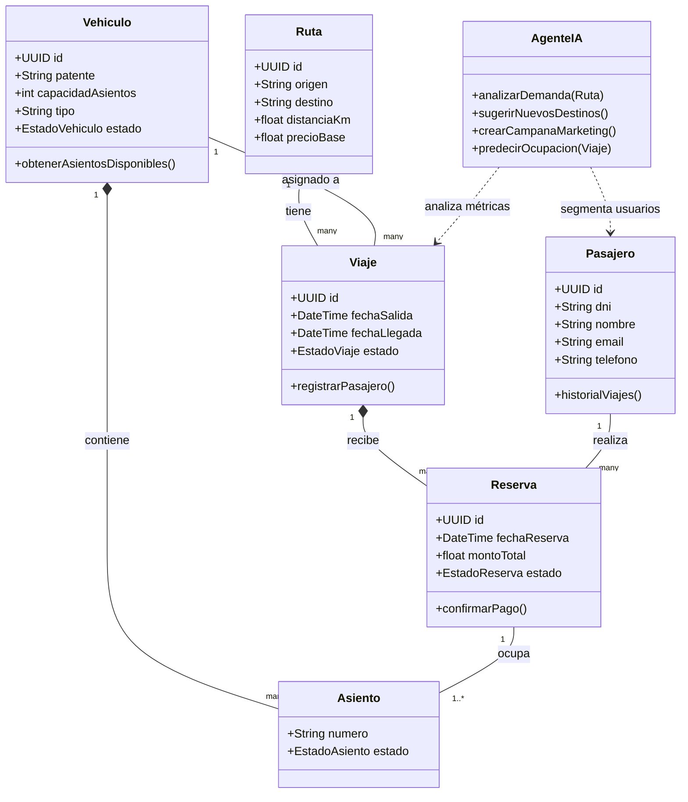
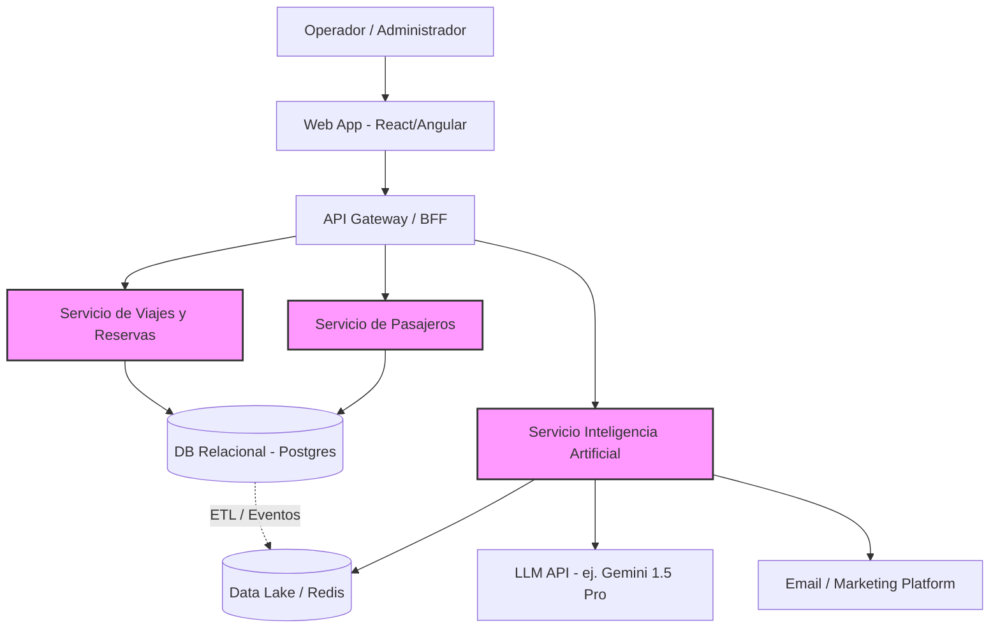

# Arquitectura y Modelado de Datos - EverTrip

Este documento provee la estructura técnica fundamental para iniciar el desarrollo, detallando el modelo de dominio y la topología de servicios propuesta.

## 1. Diagrama de Clases (Dominio Principal)

El siguiente diagrama modela el núcleo transaccional del sistema y cómo el Agente IA interactúa con los datos.

## 2. Diagrama de Arquitectura de Alto Nivel

Para escalar correctamente y poder integrar un LLM (Large Language Model) sin bloquear la operatoria, se recomienda una arquitectura orientada a servicios (SOA) o microservicios.

## 3. Justificación Tecnológica
- **Base de Datos:** Se sugiere una DB Relacional (PostgreSQL) para asegurar propiedades ACID en las transacciones de las reservas y evitar *overbooking*.
- **Agente IA:** Debe funcionar como un servicio asíncrono para no demorar la carga de la interfaz. Deberá consumir copias de solo lectura de la BD o escuchar eventos vía Webhooks/Colas (RabbitMQ/Kafka) para ir aprendiendo del flujo de ventas en tiempo real.
